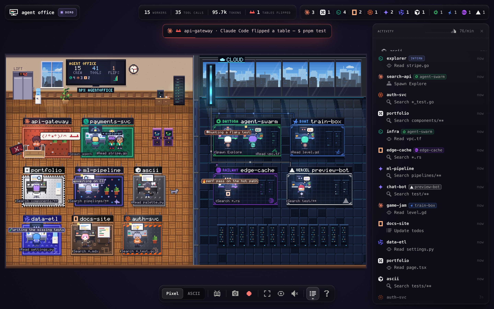
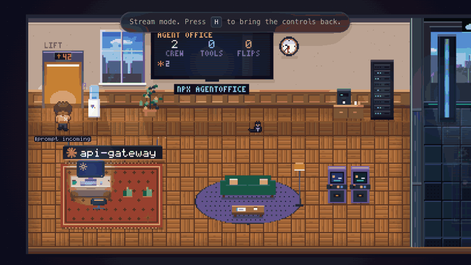
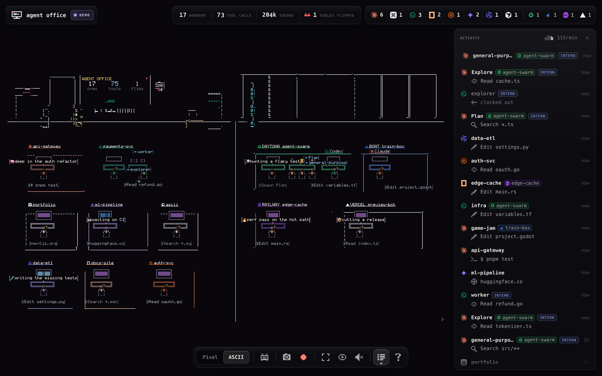
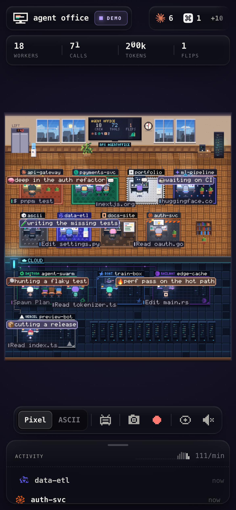

<p align="center">
  
</p>

<h1 align="center">agent office</h1>

<p align="center"><b>Your coding agents, working in a live pixel-art office.</b><br>
Every session is a worker at a desk. Subagents are interns who walk in from the lift.<br>
A failing test makes them flip the table.</p>

<p align="center">
  <code>npx agentoffice</code>
</p>

<p align="center">
  
  
  
  
  
  
  
  
  &nbsp;&nbsp;
  
  
  
  
</p>

---

agent office reads the transcripts your agents already write on this machine, in your sandboxes and on your ssh boxes, and turns them into a little office you can watch. Nothing to configure, no telemetry, zero dependencies. Open it, start an agent, and it walks in.

<p align="center">
  <br>
  <sub>The first 17 seconds of <code>npx agentoffice --demo</code> in stream mode (<kbd>H</kbd>): one desk per agent fills up, sandboxes beam into the cloud wing, and the first table flips. <a href="docs/demo.mp4">MP4 version</a>.</sub>
</p>

## Quick start

```sh
npx agentoffice          # your real agents (Node 18+)
npx agentoffice --demo   # a busy simulated office, for a first look or a recording
```

It opens `http://127.0.0.1:4747`. Start Claude Code, Codex or any agent below in another terminal and watch them sit down. Something good just happened? Press <kbd>R</kbd>: the office keeps a rolling buffer, so it saves the last ~15 seconds, with a caption for the moment burned in. <kbd>S</kbd> saves a screenshot, <kbd>A</kbd> switches to ASCII, <kbd>H</kbd> hides the controls and turns on director mode (the camera cuts to every flip, shout and arrival).

The demo starts from the top each time you open the page, so every recording opens on the arrivals.

## What you're looking at

| In the office | What happened |
|---|---|
| A worker walks out of the lift to a desk | A session started (sandboxed agents beam into the cloud wing instead) |
| A paper plane lands on the desk | You sent a prompt |
| Thought bubble | The model is thinking |
| Fast typing, code on the monitor | Editing files |
| Terminal on the monitor | Running a command |
| Sitting still, a page scrolling on the monitor | Reading files |
| Magnifier sweeping the monitor | Grep / glob / search |
| Spinning globe | Web fetch or search |
| A plug | An MCP tool call |
| Sticky notes pile up | Todo list / plan updates |
| The worker points, an intern walks in | A subagent was spawned; it leaves when it's done |
| Hand up, a bobbing "!" (the TV counts who needs you) | The turn ended and the agent is waiting on you |
| Leaning back, then asleep | Idle for a while |
| Smoke from the monitor | A tool call failed |
| Red alarm | API error or an interrupted turn |
| **(╯°□°)╯︵ ┻━┻** | **A test command failed.** A beat of hit-stop, the camera punches in, the desk flips over and lands legs-up in front of them, the monitor face down beside it; later ┬─┬ノ( º _ ºノ) |
| A cheer, the monitor goes green | Tests passed |
| Walks back to the lift | The session went quiet for 20 minutes |
| Mood chip over the head | The agent set its own status through the office MCP tools |
| The TV goes LIVE with its words, megaphone, toast | The agent shouted a milestone |
| Confetti | The agent celebrated |
| A flip with the agent's own words | The agent flipped its own table |

One pod per project: two agents on the same repo share it, each desk in its own agent's colours, both marks on the sign. The wall TV keeps score: crew, tool calls, tables flipped. The office has a day/night cycle that follows your clock, the occasional rainy day, a neon `npx agentoffice` sign, and a cat.

<p align="center">
  
  
</p>

## Supported agents

| | Agent | Reads | Status |
|---|---|---|---|
|  | **Claude Code** | `~/.claude/projects` (or `$CLAUDE_CONFIG_DIR`), subagents included | Tested |
|  | **Codex** | `~/.codex/sessions` (or `$CODEX_HOME`), subagents included | Tested |
|  | **Command Code** | `~/.commandcode/projects`, v3 and legacy formats | Tested |
|  | **opencode** | `~/.local/share/opencode/opencode.db` (read-only SQLite) | Tested |
|  | **Cursor** (cursor-agent CLI) | `~/.cursor/projects` | Tested. No pass/fail verdicts: Cursor doesn't record tool results |
|  | **Droid** (Factory) | `~/.factory/sessions` | Tested |
|  | **Qwen Code** | `~/.qwen/projects` | Tested |
|  | **Gemini CLI** | `~/.gemini/tmp/*/chats` | Untested on real data (built from gemini-cli's recorder source) |

"Tested" means checked against real transcripts on a real machine, every file, with zero crashes and zero prompt text in any label. Formats drift between versions; if your agent stops showing up, open an issue with its version.

Amp keeps its threads on its own servers, so there is nothing local to read.

## Sandboxes and remote boxes

Agents running in cloud sandboxes or on another machine sit in a glass-walled **cloud wing** next to the office, one pod per sandbox, its sign naming the platform (DAYTONA, RAILWAY, VERCEL, BOAT, SSH) in that platform's colours. Nothing is installed on the remote: the office runs plain POSIX `sh` (`find`, `stat`, `tail`, `base64`) through the platform's own exec and reads the transcripts there, exactly like it does locally.

| | Where | How it connects | Status |
|---|---|---|---|
|  | **Vercel Sandbox** | REST API with `VERCEL_TOKEN`/`VERCEL_OIDC_TOKEN`, or the `npx sandbox` CLI's login | Tested |
|  | **Daytona** | `DAYTONA_API_KEY`, or the `daytona` CLI's login | Tested |
|  | **Railway Sandboxes** | `RAILWAY_API_TOKEN`, or the `railway` CLI's login | Tested |
|  | **boat** | `BOAT_API_KEY`, or the `boat` CLI; only with `--boat` (see below) | Untested on a real VM (built from docs.boat.dev and its OpenAPI spec) |
| | **Any ssh box** | your own `ssh`, `BatchMode=yes`, one multiplexed connection | Beta |

**Auto-detect.** On start the office looks for those keys and CLI logins (files and environment only, no network). A platform you're logged in to gets its running sandboxes listed and watched, but only in your own scope, so a teammate's sandbox never ends up in your recording:

- **Vercel:** your default team (and the CLI's `vercel-sandbox-default-project`, or a linked project).
- **Railway:** the project and environment `railway link` tied to the folder you start the office in, plus the sandboxes your own `railway` CLI created.
- **Daytona:** your personal organization. A shared team organization is skipped.
- **boat:** never. boat keeps every command run through its API, with its output, for 90 days, and the office's reads are transcript bytes, so boat is watched only when you ask with `--boat` (the banner reminds you).

A sandbox that stops sends its workers home. Turn auto-detect off with `--no-cloud` or `"cloud": false`.

**Flags.** `--vercel [name]`, `--daytona [id]`, `--railway [id]`, `--boat [id]` (no value means every running one the login can see, in every team or workspace), `--ssh <host>` (repeatable; an alias, `user@host` or `ssh://user@host:port`), `--local-only` to ignore all of it.

**Config file.** Remotes you always want go in `~/.agentoffice/config.json`:

```json
{
  "remotes": [
    { "ssh": "me@gpu-box" },
    { "ssh": "build", "env": { "CLAUDE_CONFIG_DIR": "/data/claude" } },
    { "vercel": "all" },
    { "daytona": "all" }
  ],
  "cloud": true
}
```

**Being a good tenant.** A quiet poll is one exec of a few hundred bytes: only files touched since the last full scan are listed, and transcript bytes come back gzipped. Remote polls back off when a host stops answering (it dims and shows OFFLINE), quiet Daytona and Railway sandboxes with an idle timeout stop being polled so they can still auto-stop, each Railway sandbox gets an even share of under half your API rate limit (a poll that costs more simply waits longer; hitting the budget pauses polling, it never marks the sandbox offline), and expired logins are reported, never refreshed behind your back. Display names and error messages never show a full IP address.

### Claude in a Vercel Sandbox, in your office

```sh
npx sandbox@latest login     # once; the office reuses this login
npx sandbox@latest sh        # creates a sandbox and opens its shell
claude                       # inside the sandbox; Claude Code, Codex and opencode are pre-installed
```

Claude Code signs in separately inside the sandbox. In another terminal on your machine, `npx agentoffice` finds the sandbox (the CLI puts it in your team's `vercel-sandbox-default-project`) and the worker beams into the cloud wing.

- The shell's sandbox stops on its own when its timeout expires (5 minutes by default, `--timeout 30m` for longer).
- The filesystem is restored when you reconnect, so the agent's login persists. Run `claude auth logout` before `exit` if you don't want that.
- Exiting saves a snapshot by default, and the snapshot keeps accruing storage cost until the sandbox is removed. Start with `npx sandbox@latest sh --rm` to leave nothing behind, or clean up later with `npx sandbox@latest rm <sandbox-name> --delete-orphan-snapshots`.
- agent office only reads transcripts. It does not broker credentials or restrict the sandbox's outbound traffic.

## The office MCP server and skill

Agents can talk back. `agentoffice mcp` is a zero-dependency MCP server (stdio) with five tools, plus a short skill that teaches agents when to use them:

| Tool | What it does |
|---|---|
| `office_status {text, mood?}` | Sets the status line and emoji floating over the agent's head |
| `office_peers {}` | Who else is working right now, what they're doing, and which files they just edited. Agents in the same repo come first, with a heads-up before two of them edit the same file |
| `office_shout {text}` | Puts a milestone on the office TV and in a toast (rate-limited) |
| `office_celebrate {reason?}` | Confetti at the agent's desk |
| `office_flip {reason?}` | The agent flips its own table, in its own words (once every 2 minutes per repo) |

Everything an agent sends is scrubbed before it reaches the screen, by the MCP server and again by the office: paths become file names, URLs become host names, emails and anything that looks like a secret become `•••`, 64 characters max. A signal goes to the worker whose transcript shows it calling that tool, so twin sessions in one repo each get their own.

`office_peers` hands other agents' self-reported text to the agent that asked, so it quotes every such field and says it's data, not instructions; agents in sandboxes are described only by structure (agent, host, kind of tool). The office proves itself to the MCP server with a secret it writes to `~/.agentoffice/office.json` on start, so another program listening on a nearby port can't pose as it.

**Install into every agent at once:**

```sh
npx agentoffice install --dry-run   # the plan and the exact diff of every file it would touch
npx agentoffice install             # do it
npx agentoffice doctor              # what's installed where, and is the office running
npx agentoffice uninstall           # put every file back the way it was
```

| Agent | MCP server registered in | Skill |
|---|---|---|
| Claude Code | `claude mcp add --scope user` (`~/.claude.json`) | `~/.claude/skills/agent-office` |
| Codex | `codex mcp add` (`~/.codex/config.toml`) | `~/.agents/skills/agent-office` |
| Command Code | `~/.commandcode/mcp.json` | `~/.commandcode/skills/agent-office` |
| opencode | `~/.config/opencode/opencode.json` | `~/.config/opencode/skills/agent-office` |
| Droid | `~/.factory/mcp.json` | `~/.factory/skills/agent-office` |
| Qwen Code | `~/.qwen/settings.json` | `~/.qwen/skills/agent-office` |
| Cursor | `~/.cursor/mcp.json` | `~/.cursor/skills/agent-office` |
| Gemini CLI | `~/.gemini/settings.json` | `~/.gemini/skills/agent-office` |

It only touches agents it finds. Edits change just the `agentoffice` entry and keep your comments, key order and formatting; every changed file gets a timestamped backup next to it first; a file that doesn't parse is left alone and reported. Re-running is a no-op, and `uninstall` restores each file byte for byte. `--agents claude,codex` limits it, `--no-skill` / `--no-mcp` skip half.

**In a sandbox or on a box:** add the same target flags, e.g. `npx agentoffice install --vercel all` or `--ssh me@gpu-box`. Remote installs need Node 18+ there and register `npx -y agentoffice@<this exact version> mcp`: pinned, never `@latest`, and the installer refuses unless that version is really on npm. Signals from remote agents come back through the same transcript polling, so a sandboxed agent's mood shows up over its head in the cloud wing.

If the user added their own keys to the `agentoffice` entry (an `env`, a timeout), re-installing keeps them, and `--dry-run` masks secrets anywhere in a line, minified configs included.

## Privacy

agent office is built to be screen-recorded.

- **Local only.** The server binds `127.0.0.1`, rejects requests with a foreign `Host` (and cross-site requests to its API), and sends a strict CSP. `--host` exists, and warns you when you use it.
- **Read-only.** It never writes to your agents' transcripts or configs (only `install` touches configs, and only with your say-so).
- **Nothing leaves your machine** except the calls to the sandbox platforms and ssh boxes you're logged in to or configured, to list sandboxes and read transcripts inside them. No telemetry, no CDN, no network at runtime; it works offline.
- **Labels, not content.** What reaches the browser is an action and a file name ("Edit auth.ts", "$ npm test"). Never prompt text, file contents, command arguments past the subcommand, or anything that looks like a key or token. Your home directory shows as `~`, ssh hosts show as their alias with IPs masked.

## How it works

```
 ~/.claude  ~/.codex  ~/.commandcode  opencode.db  ...      sandboxes / ssh boxes
        \        |         |            /                   (same reads, over sh)
         ingest: one small parser per agent  <──────────────────────┘
                 │  RawEvent: "worker X started Edit auth.ts"
         state:  re-redacts, ages workers out (idle 90s, home after 20 min)
                 │  Server-Sent Events on 127.0.0.1
         browser: Canvas 2D office drawn at pixel resolution, scaled crisp
```

The CLI tails transcript folders (polling, plus `fs.watch` hints where reliable), backfills sessions active in the last 30 minutes, and streams one event per line it understands. The office is drawn at true pixel-art resolution into an offscreen buffer and scaled up with crisp pixels; labels, ASCII mode and CRT are passes on the same canvas, so screenshots and clips include them. No framework, no runtime dependencies: one bundled `dist/cli.js` and one bundled web app.

## CLI

```
npx agentoffice [office] [options]     open the office (the default command)
npx agentoffice <command> [options]    install | uninstall | doctor | mcp

  --port <n>, -p    Port (default 4747; tries the next 20 if taken)
  --host <addr>     Interface to bind (default 127.0.0.1)
  --agents <list>   claude,commandcode,codex,opencode,droid,gemini,qwen,cursor (default all)
  --demo            A simulated office; reads no transcripts
  --seed <n>        Demo seed, for reproducible recordings (default 7)
  --no-open         Don't open the browser
  -q, --quiet       Banner only, no arrivals or table flips in the terminal
  --verbose         Log what the watchers are doing
  --ssh <host>      Watch an ssh box (repeatable)
  --vercel [name]   --daytona [id]   --railway [id]   --boat [id]
  --no-cloud        Don't auto-detect sandbox platforms
  --local-only      This machine only
```

`AGENT_OFFICE_HOME` moves `~/.agentoffice` (config, the running office's `office.json`, agent signals). `AGENT_OFFICE_<AGENT>_DIR` points one agent at a non-default folder.

## Keyboard

| Key | |
|---|---|
| <kbd>A</kbd> | Pixel / ASCII |
| <kbd>C</kbd> | CRT scanlines |
| <kbd>S</kbd> | PNG screenshot |
| <kbd>R</kbd> | Clip that: save the last ~15 seconds, caption and `npx agentoffice` mark burned in |
| <kbd>Shift</kbd>+<kbd>R</kbd> | Record the next 10 seconds (again to stop early) |
| <kbd>F</kbd> | Fullscreen |
| <kbd>H</kbd> | Stream mode: hide the chrome; the camera cuts in on every big moment, with letterbox bars and a caption |
| <kbd>M</kbd> | Sound (off by default) |
| <kbd>\\</kbd> | Show / hide the activity feed |
| <kbd>?</kbd> | All shortcuts |
| <kbd>Esc</kbd> | Leave stream mode, close the inspector |

Click a worker for its inspector (model, host, tool calls, tokens, recent actions). Scroll to zoom, drag to pan, double-click to reset.

## Develop

```sh
npm install
npm run dev          # build, then run the demo
npm test             # build, then every test in test/
npm run typecheck
node web/ui/dev/dev-server.mjs --scenario cloud   # the web app against a synthetic event stream
```

TypeScript and Node built-ins on the server, vanilla TypeScript and Canvas 2D in the browser, esbuild to bundle. Test fixtures are synthetic; nothing from a real transcript lives in this repo.

## Trademarks

Claude, Codex, Command Code, opencode, Cursor, Droid/Factory, Qwen, Gemini, Daytona, boat, Railway and Vercel are trademarks of their respective owners. Their logos are used only to identify those products; agent office is not affiliated with or endorsed by any of them. Codex is shown with a neutral hexagon rather than OpenAI's logo.

## License

[MIT](LICENSE)
